[](https://miladnalbandi.com)
[](https://www.linkedin.com/in/milad-nalbandi-562281165)
[](mailto:m.nalbandi.r@gmail.com)

I build backend systems in **Python and PHP** (8+ years) and, in the open,
**tools that make AI coding agents write tested, reviewable code** instead of plausible-looking code.

> 💼 **Open to Python, PHP and AI engineering roles** in Düsseldorf / NRW or remote in Germany.
> Reach me at [m.nalbandi.r@gmail.com](mailto:m.nalbandi.r@gmail.com) or on [LinkedIn](https://www.linkedin.com/in/milad-nalbandi-562281165).

---

### ⚓ [keel](https://github.com/MiladNalbandi/keel-v2) — AI agents write _tested_ code for your project; you approve the important steps

<a href="https://github.com/MiladNalbandi/keel-v2"></a>

```
 "show each player's rank"
   1. spec    an agent writes what to build                ◆ you approve
   2. test    an agent writes a test that fails
   3. code    an agent writes code until the test passes   ◆ you approve
   4. review  agents check the whole change                ◆ you approve
   → tested commits on a new branch. keel never pushes.
```

- Python engine and API, one Docker container: web dashboard, terminal app, and an **MCP server** for your own AI tools
- Works with **Claude, Codex, GitHub Copilot, Vertex AI** or local models (Ollama, LM Studio, vLLM)
- Small core + plugins (Git, CI/CD, database, code review, Jira), a quality page that tracks each flow per model, and a token budget bar
- Started as a [Claude Code plugin](https://github.com/MiladNalbandi/keel) whose hooks enforce RED → GREEN per acceptance criterion

`Python` · `TypeScript` · `MCP` · `LLM agents` · `Docker`

---

### More AI + Python projects

<table>
<tr>
<td width="50%" valign="top">

#### 🧭 [Founder's Cockpit](https://github.com/MiladNalbandi/founders-cockpit)

A desktop app where a team of **Claude agents** (CEO, product, design, engineering, plus an always-on advisor) works on a startup project. Each agent has a tool allowlist and runs inside a sandboxed workspace. You watch them live and read what they wrote. [Tutorial →](https://miladnalbandi.github.io/founders-cockpit/tutorial.html)

`Python` · `Django` · `DRF` · `Channels` · `Celery` · `Anthropic SDK`

</td>
<td width="50%" valign="top">

#### 🧩 [Blueprint Studio](https://github.com/MiladNalbandi/blueprint-studio)

Design a backend API on a canvas and **generate a full codebase** in Python, PHP, TypeScript, Go or Java. An AI chat assistant edits the graph for you, and an AI function builder fills in business logic. _Alpha._

`Python` · `FastAPI` · `Jinja` · `TypeScript` · `LLM tool use`

</td>
</tr>
</table>

### For PHP developers

<table>
<tr>
<td width="50%" valign="top">

#### 📦 [Composer Command Helper](https://plugins.jetbrains.com/plugin/27215-composer-command-helper)

PhpStorm plugin for Composer: one-click commands and dependency install/remove inside the IDE, without blocking the editor. **~600 active users** on the JetBrains Marketplace.

`PHP tooling` · `Composer` · `IntelliJ Platform`

</td>
<td width="50%" valign="top">

#### 🖨️ [ZPL Label Viewer](https://github.com/MiladNalbandi/zpl-label-viewer) · [zpl-renderer](https://github.com/MiladNalbandi/zpl-renderer)

A PhpStorm/IntelliJ plugin that previews **ZPL II shipping labels** right in the editor, built on my own renderer. No printer, no Labelary, no data leaving the machine.

`PhpStorm` · `Kotlin` · `Apache-2.0`

</td>
</tr>
</table>

**Also built:** [Latch](https://github.com/MiladNalbandi/latch), a private clipboard history for macOS (`brew install --cask latch`) ·
[Ludus Engine](https://github.com/MiladNalbandi/ludus-engine), an open-source backend for 2D games (Java, hexagonal, early).

---

### Day job

**Senior Software Engineer @ METRO Markets** (since 2022): backend services for the delivery domain
across five European markets, written mostly in **Python** today, plus PHP/Symfony
(DDD, hexagonal, message-driven integrations with carriers),
and the team's AI ambassador for spec-driven development with AI coding agents.

```
Backend   Python · Django · FastAPI · PHP 8 · Symfony · SQL · PostgreSQL
AI        LLM agents · tool use · MCP · RAG · LLM eval loops · Claude Code · Codex
Async     RabbitMQ · Kafka · Symfony Messenger · Celery
Infra     Docker · Kubernetes · GCP · GitHub Actions · Grafana / Prometheus
Also      Java · Kotlin · TypeScript
Language  English (fluent) · German (B1) · Persian (native)
```

---

**More:** [miladnalbandi.com](https://miladnalbandi.com) (CV and blog) ·
[blog](https://miladnalbandi.com/blog) · [LinkedIn](https://www.linkedin.com/in/milad-nalbandi-562281165)
